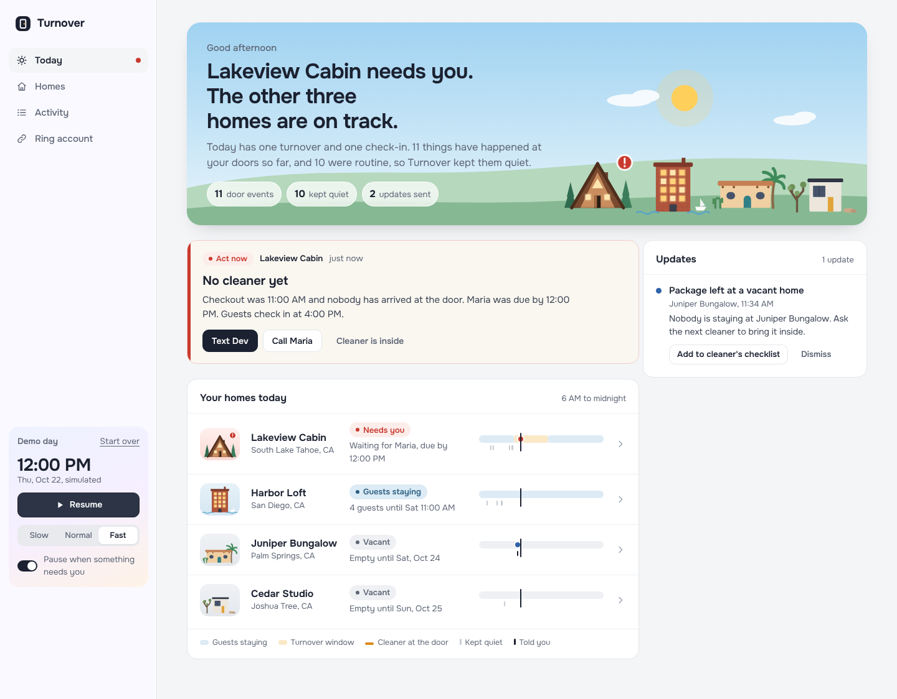
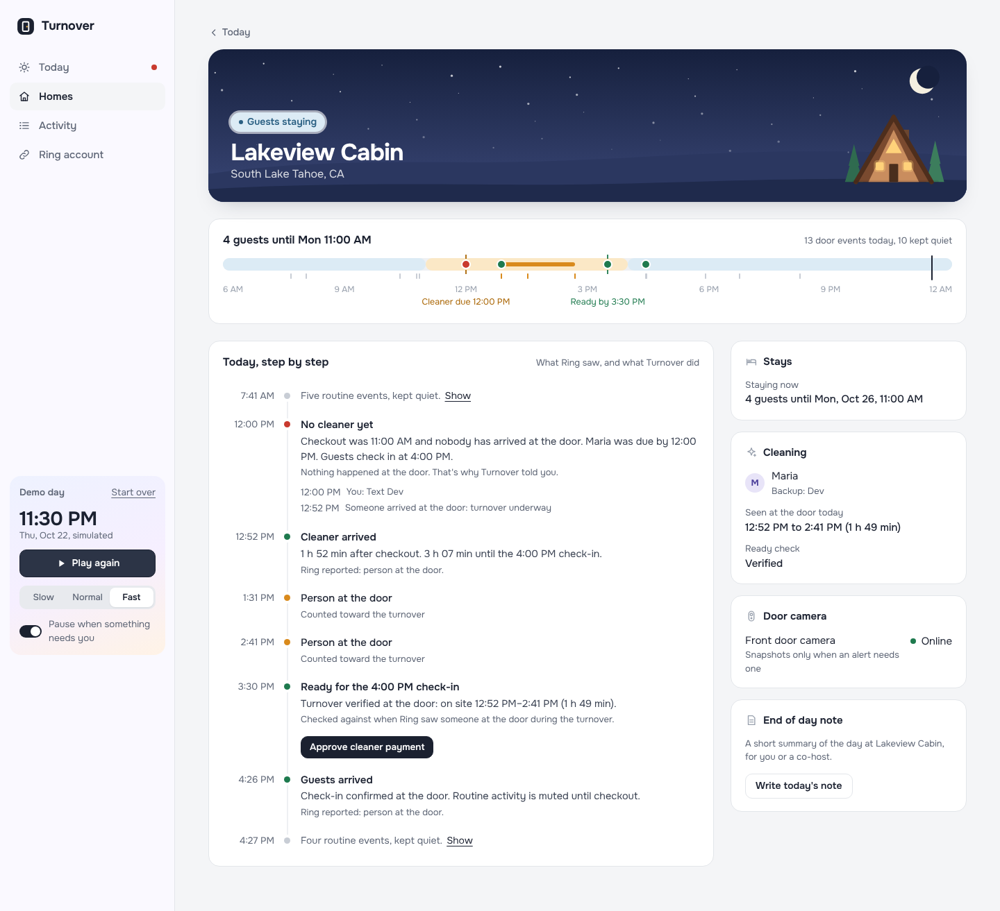
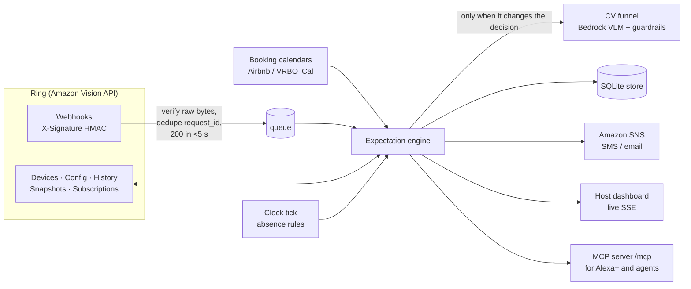

# Turnover

**Your Ring doorbell, read against your booking calendar.**

Turnover is a Ring Appstore app for short-term-rental hosts. It joins each home's booking calendar (the iCal export Airbnb, VRBO and Booking.com already publish) with that home's Ring camera, so every door event is judged against what *should* be happening there today.

- **It alerts on what didn't happen.** "No cleaner yet at Lakeview Cabin. Checkout was 11:00, guests check in at 4:00." Ring can't send that, because nothing happened.
- **It mutes what's expected.** Guests walking to the beach during their stay never reach the host's phone. In the demo day, 22 of 28 Ring events are muted, and every one is logged with the reason.
- **It confirms the business events.** Cleaner arrived, turnover verified at the door (on site 12:52–2:41, 1 h 49 min), guests checked in, camera back online.
- **It escalates when the context says so.** A person at a vacant home gets an alert with a snapshot. So does a possible gathering after quiet hours, checked by a vision model against the booking's guest count, with guardrails and no identification of anyone.

Built for the Ring track of the [Amazon Developer Hackathon 2026](https://amazonappdev2026.devpost.com/), in the priority categories business systems, access control and IoT home automation.





---

## Run it in two minutes

```bash
git clone https://github.com/<you>/turnover && cd turnover
pip install -r requirements.txt
uvicorn turnover.app:create_app --factory --port 8000
```

Open http://localhost:8000 and press **Play the day**. A full day across four homes (today's date) plays out in about two minutes. It pauses when something needs you, so you can press **Text Dev** on the no-show alert.

No Ring account or AWS credentials are needed for the demo. Every event is a signed Ring webhook going through the real `/webhooks/ring` handler.

To use the real Ring API, click **Ring account** in the sidebar and paste a [Developer Playground](https://developer.amazon.com/ring/console/playground) token. Your real devices are listed, with their encryption status, and you can assign them to homes.

To use Amazon Bedrock for the vision check and the daily brief:

```bash
export AWS_REGION=us-east-1 BEDROCK_ENABLED=1 BEDROCK_MODEL_ID=us.amazon.nova-lite-v1:0
uvicorn turnover.app:create_app --factory --port 8000
```

---

## How it works



### The expectation engine

For each home, the calendar puts every moment in one of three states. Each Ring event is handled according to that state:

| State | Person or doorbell | Package | Vehicle | Nothing at all |
|---|---|---|---|---|
| **Guests staying** | Muted. The first one after check-in confirms the guests arrived. During quiet hours, several arrivals trigger the gathering check. | Muted | Muted | No guest arrival by check-in + 6 h: low-key note |
| **Turnover window** (checkout → next check-in) | The cleaner's visit: first and last seen at the door | Muted (the cleaner brings it in) | Muted | **Cleaner not there by checkout + grace: urgent.** Not verified by 30 min before check-in: urgent. Visit shorter than the minimum: look soon. |
| **Vacant** | **Urgent, with snapshot** | Good to know | During quiet hours: look soon | — |

The engine also handles these:
- **Camera offline or online.** It's urgent when the home is vacant or in a turnover, because that's a blind spot. The alert resolves itself when the camera reconnects.
- **Subscription activated or deactivated.** Monitoring is enabled or paused per home.
- **Integration removed.** Turnover deletes its tokens and snapshots.

### Following Ring's own guidance

| Ring guidance | Where in the code |
|---|---|
| Verify `X-Signature` (hex HMAC-SHA256) over the **raw** body before parsing | `turnover/ring/webhooks.py`, `app.py:ring_webhook` |
| Dedupe on `meta.request_id` (Ring retries); respond within 5 s and process asynchronously | `app.py` (insert-once + queue) |
| `sub_type` is an open vocabulary; with Smart Alerts off every event is `motion` and no API says which (Oct 5 2026) | `engine._classify`: unknown values pass through; `motion` goes to the CV funnel only where it changes the decision |
| Tiered CV funnel; guardrails before output reaches the user (CV Guidelines, Oct 19 2026) | `turnover/vision.py`: Ring's classification, then context gate, snapshot, Bedrock. Then schema check, block list, confidence floor, context check against Ring's own signal, and a defined fallback |
| `configurations.e2e_encryption.enabled` is a JSON boolean; TAKE devices return unreadable video (Oct 9 2026) | `ring/client.py:Device.encrypted`; encrypted devices never go to CV |
| Location-scoped subscriptions: read **both** `devices` and `locations` relationships (Oct 12 2026) | `ring/client.py:parse_subscriptions` |
| One-way account linking: unclaimed tokens, mandatory sign-in, nonce `HMAC(time:account_id)` as URL-safe base64 without padding, 600 s window, POST then PATCH | `turnover/ring/linking.py`, `app.py:/ring/*` |
| Refresh proactively; the new refresh token replaces the old; 401 → refresh once → re-link | `TokenManager`, `RingClient._request` |
| 429 → `Retry-After` and exponential backoff; 303 media redirect fetched **without** the bearer | `RingClient._request` |
| Webhooks can be missed; Event History is the source of truth | `app.py:reconcile`, every 10 min, deduplicated |
| `device_offline` lags real loss of connectivity | Alert copy says "stopped reporting", not an exact time |
| Multi-camera devices: one component per snapshot request | `RingClient.snapshot(component_id=…)` |

### Privacy by design

- No face recognition and no identification. The vision prompt forbids describing people, and a block list strips descriptive words from the one free-text field.
- Video is pulled only when it changes the outcome. That means activity at a vacant home, a possible gathering, or an unclassified motion at a vacant home or during a turnover. It is never pulled to confirm a guest check-in or a cleaner's arrival.
- Snapshots are kept for 7 days, for review only.
- Removing Turnover in the Ring app deletes its tokens and media.
- Exterior doorbell cameras only. Hosts must disclose cameras to guests, as Airbnb's policy requires.

---

## Voice: Turnover as an MCP server

`/mcp` serves the Model Context Protocol over Streamable HTTP. The SDK negotiates spec 2026-07-28, which meets the hackathon's 2025-11-25-or-later requirement. An assistant such as Alexa+ can then answer *"Is the cabin ready for tonight?"* from the same engine:

| Tool | Answers |
|---|---|
| `homes_overview` | "1 of your 4 homes needs attention. Lakeview Cabin: no cleaner yet." |
| `home_status(home)` | "Lakeview Cabin is occupied. The cleaner arrived at 12:52 PM… It's verified ready for check-in. Guests arrived at 4:26 PM." |
| `recent_alerts` | Latest open alerts across homes |
| `text_backup_cleaner(home)` | Messages the backup cleaner, but only if a cleaning was actually missed |

Every result includes a `say` field written to be spoken aloud. Try it with the MCP Inspector:

```bash
npx @modelcontextprotocol/inspector   # Transport: Streamable HTTP, URL: http://localhost:8000/mcp
```

---

## Deploy to AWS

`scripts/deploy_aws.sh` deploys to **Amazon ECS Express Mode**. AWS App Runner stopped accepting new customers on April 30, 2026, and ECS Express Mode is AWS's recommended path. The script creates or reuses:

- an **ECR** repository;
- **Secrets Manager** secrets for the Ring client secret, HMAC key and dashboard password;
- an **SNS** topic for host alerts;
- least-privilege **IAM** roles (the task role can call Bedrock and publish to that one topic, nothing else);
- the Express service, which provides HTTPS, a load balancer and logs.

```bash
export AWS_REGION=us-east-1 ALERT_EMAIL=you@example.com DASHBOARD_PASSWORD='pick-one'
export RING_HMAC_KEY=... RING_CLIENT_ID=... RING_CLIENT_SECRET=...   # optional for the demo
./scripts/deploy_aws.sh
```

It prints the four URLs to paste into the Ring Developer Portal (Webhook, Token Exchange, Account Link, App Homepage). Before deploying, enable your Bedrock model in the Bedrock console (Model access).

**AWS services used:** Amazon Bedrock (Converse API with image input, Amazon Nova Lite by default, optional Bedrock Guardrails), Amazon SNS, Amazon ECS Express Mode on Fargate, Amazon ECR, AWS Secrets Manager, IAM, CloudWatch Logs.

---

## Connect a real Ring account

1. Create an app in the [Ring Developer Portal](https://developer.amazon.com/ring/console/apps). The **Private Apps** track allows up to 5 allowlisted accounts without certification. Save the Client ID, Client Secret and HMAC Signing Key; they are shown once.
2. Register the endpoints that `deploy_aws.sh` printed:

   | Ring setting | Turnover route |
   |---|---|
   | Token Exchange URL | `/ring/token-exchange` |
   | Account Link URL | `/ring/link` |
   | Webhook URL | `/webhooks/ring` |
   | App Homepage URL | `/ring/setup` |

3. Install the app from the Ring app. Sign in on Turnover's link page, assign cameras to homes, and press **Finish setup**. Turnover sends `PATCH status=completed` only then.
4. Add each home and import its calendar:
   ```bash
   curl -X POST https://<host>/api/properties -H 'Content-Type: application/json' -u host:$DASHBOARD_PASSWORD \
     -d '{"name":"Pine Hollow","city":"Bend, OR","timezone":"America/Los_Angeles","checkin_time":"16:00","checkout_time":"11:00",
          "max_guests":6,"cleaner_name":"Sam","backup_cleaner_name":"Jo","ical_url":"<your Airbnb iCal export URL>"}'
   ```
   Do this before step 3 so the homes appear on the setup page. Run with `TURNOVER_DEMO=0` for a real clock and no demo homes.

Send a signed test webhook to any running instance:

```bash
python -m turnover.simulator send --url https://<host>/webhooks/ring --key "$RING_HMAC_KEY" \
  --device ava1.ring.device.XXXX --type motion_detected --sub-type human
```

---

## Tests

```bash
pip install -r requirements-dev.txt
pytest -q
```

The 17 tests cover the following:
- Signature verification, including rejecting re-serialized JSON.
- Nonce encoding and the freshness window.
- Matching a nonce to the right unclaimed token, and the whole linking flow through the real routes: sign-in before any nonce check, POST to `awaiting`, setup, then PATCH `completed`.
- The dashboard password protecting the dashboard while leaving Ring's routes open.
- The encryption flag being a JSON boolean, and location-scoped subscriptions.
- The vision guardrails.
- The MCP tools.
- The full demo day driven through the real webhook route: every expected alert, the self-resolving no-show and offline alerts, no snapshot on check-in confirmations, and the muted count.

## Project layout

```
turnover/
  app.py            web service: Ring webhook, account linking, dashboard API, demo controls
  engine.py         expectation engine: state machine, absence rules, dispositions
  bookings.py       iCal import and the vacant / occupied / turnover state of a home
  vision.py         CV funnel tier 3 (Bedrock) and output guardrails
  media.py          snapshots on demand, encrypted-device handling, retention
  brief.py          end-of-day brief, facts computed in code and phrased by Bedrock, checked
  notify.py         live dashboard feed and Amazon SNS
  mcp_server.py     MCP tools for voice assistants
  simulator.py      the demo day as signed webhooks, and a CLI to send one
  ring/
    client.py       Ring Partner API client
    webhooks.py     X-Signature verification and v1.1 parsing
    linking.py      one-way account linking and token lifecycle
  static/           dashboard (HTML, CSS, JS, self-hosted Onest font)
demo/images/        illustrated doorbell frames for the offline demo (replace with your own photos)
scripts/            deploy_aws.sh, make_demo_frames.py, screenshot.py
docs/               submission notes, product feedback, friction log, open-source contribution
```

## Limitations and next steps

- Storage is SQLite on one task. Next: a DynamoDB adapter (the `Store` interface is four methods) and S3 for snapshots.
- A doorbell sees arrivals and departures, not the time spent inside. Ring's early-access contact sensors would make the visit duration exact; the engine already treats sensors as devices.
- Calendar import is iCal. Next: channel-manager APIs (Guesty, Hostaway) for guest counts and cleaner schedules.

## License

MIT, see [LICENSE](LICENSE). The bundled Onest font is under the SIL Open Font License (`turnover/static/fonts/OFL.txt`). "Ring" is a trademark of Ring LLC; Turnover is an independent app built on the Ring Partner API.
